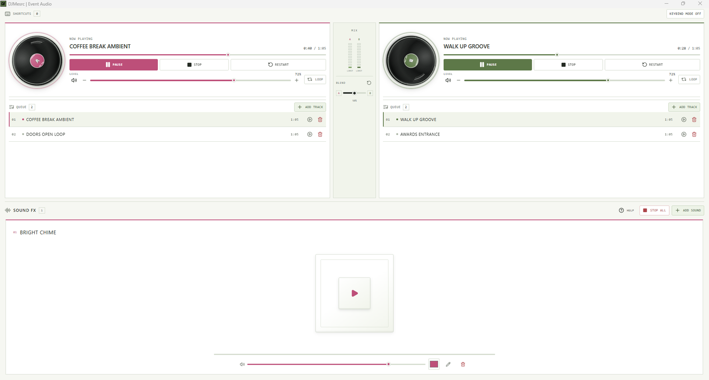

# DJMesrc

DJMesrc is a Windows event audio desk for small events and company teams. It puts two independent music decks and a soundboard in one clear workspace so staff can run music without learning professional DJ software.

[](https://github.com/MoonWIRaja/DJMesrc/releases/latest)
[](https://github.com/MoonWIRaja/DJMesrc/actions/workflows/website.yml)
[](https://github.com/MoonWIRaja/DJMesrc/actions/workflows/release-windows.yml)

## Download

Get the [latest Windows installer](https://github.com/MoonWIRaja/DJMesrc/releases/latest). Each release includes the setup EXE, MSI package and SHA-256 checksums. The product [website](https://moonwiraja.github.io/DJMesrc/) checks GitHub Releases for the current version and direct download links.

## See DJMesrc in use

[](apps/website/public/media/usage-demo.mp4)

[Watch the one-minute workflow demo](apps/website/public/media/usage-demo.mp4) or read the [quick-start guide](docs/quick-start.md).

## How to use it

1. Add audio to Deck A, Deck B or both with **ADD TRACK**. Neither deck has a fixed role, so choose which one carries background music and which one carries event music.
2. Build each queue by dragging tracks into order. Select a queued track to play it immediately, or right-click a track for its available actions. With Loop off, the queue advances after a track ends. With Loop on, the current track repeats.
3. Use each deck's volume control or the center crossfader to bring one source forward and lower the other. Pause preserves the current position. Stop fades a deck when both decks are playing; a solo deck stops directly.
4. Add short audio cues to **SOUND FX** and play them when needed. Multiple effects can overlap. Music is lowered while effects play and returns to its prior level after the last effect finishes.
5. Use the one-time first-launch tutorial to try the main controls. Keyboard shortcuts can be assigned in the app; Escape cancels or clears a key while assigning.

The app supports MP3, WAV, FLAC, OGG, AAC and M4A audio, subject to the actual file encoding. Music remains in the locations selected by the operator; DJMesrc stores the paths used by the session.

## Features

- Two independent music decks with individual playlists and controls.
- Drag-to-reorder queues, immediate Play Now selection, Loop and queue rotation.
- Center crossfader, per-deck volume and mute.
- Fade-aware Stop when both decks are playing.
- Soundboard with per-pad volume, color and name, overlapping playback, music ducking and Stop All.
- Live signal meters, master limiter, session restoration and missing-file relinking.
- First-run tutorial and assignable keyboard shortcuts with duplicate prevention.

## Build from source

Requirements: Windows x64, Node.js 22, pnpm 12, Rust stable/MSVC build tools, WebView2 and Tauri's Windows packaging prerequisites.

```powershell
corepack pnpm install --frozen-lockfile
corepack pnpm dev
corepack pnpm check
corepack pnpm build
corepack pnpm tauri build
corepack pnpm site:dev
corepack pnpm site:build
```

The desktop installers are generated under `apps/desktop/target/release/bundle/`. The website source is in `apps/website`; its static output is in `apps/website/dist/`.

## Project layout

- `apps/ui` - React and TypeScript desktop interface and focused components.
- `apps/desktop` - Tauri v2 shell, Rust audio engine and Windows packaging.
- `apps/website` - product site and GitHub Pages build.
- `packages/domain` - shared playlist and audio-domain types.
- `docs` - product requirements, quick start, media script and release notes.

## Project status

DJMesrc is an actively developed MVP. The source and installer build successfully, and the core playback, queue and soundboard flows have been exercised on Windows. Hardware diversity, clean-machine installation and live-event reliability still need wider field testing.

Report a reproducible bug through [GitHub Issues](https://github.com/MoonWIRaja/DJMesrc/issues).
